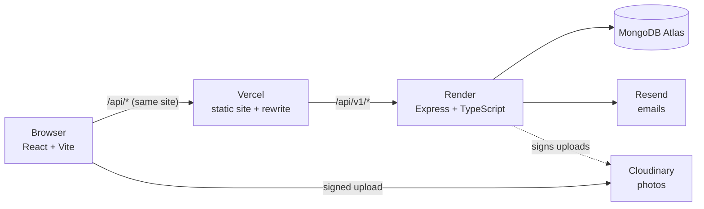

# VoltNest

A full-stack e-commerce shop for charging gear, modelled on how anker.com is structured and behaves, built for the Bangladesh market. Customers browse, filter and order with Cash on Delivery. The owner and employees run orders, stock and products from an admin panel.

**Live:** https://YOUR-SITE.vercel.app  ·  **Demo video:** _add link_

> Structure and behaviour are inspired by anker.com. All brand names, product names, images and copy are original.


## What it does

**For shoppers**
- Home page with hero carousel, category rail, New arrivals / Bestsellers tabs
- Collection pages with filters (price, wattage, capacity, ports, in stock) kept in the URL, sorting and Load more
- Product pages with gallery, variant picker (`?variant=` in the URL), specs and verified reviews
- Cart that lives on the server: a guest cart follows you when you log in
- Checkout with three delivery zones (Inside Rajshahi ৳50, Inside Dhaka ৳50, elsewhere ৳120) and Cash on Delivery
- Order emails at every step (placed, confirmed, on the way, delivered, cancelled)
- My orders with a status timeline, guest tracking by order number + phone, reviews after delivery

**For the shop**
- Admin panel at `/admin` for the **owner** and **staff**
- Orders: filter, search by number / phone / name, confirm → ship (courier + tracking) → deliver, cancel with stock returned
- Products: create and edit with variants, prices, cost price, stock and photos (Cloudinary)
- Dashboard: orders to confirm, today's orders, value and profit, deliveries due in 3 days, low stock
- Staff accounts the owner can switch off instantly. Staff never see cost, profit or revenue

| | Owner | Staff |
|---|---|---|
| Orders: view, confirm, ship, deliver, cancel | ✓ | ✓ |
| Update stock | ✓ | ✓ |
| Create / edit products and prices | ✓ | |
| Cost price, profit, revenue | ✓ | |
| Manage staff accounts | ✓ | |


## Architecture



- **Same-site API.** Vercel rewrites `/api/*` to Render, so the browser only ever talks to one site. Login cookies stay `httpOnly`, `Secure` and `SameSite=Lax`, with no CORS headaches.
- **Server decides the money.** The browser sends only contact, address and zone. Prices, delivery charges and totals are calculated on the server from the database, inside a MongoDB transaction that also takes the stock, so two people can never buy the last unit.
- **Snapshots for reporting.** Every order stores `unitPrice`, `unitCost`, `expectedDeliveryDate` and a `statusHistory` with who changed what, so profit and delivery reports stay correct even when prices change later.
- **Three scaling rules.** Every feature has its own folder (`server/src/modules/*`, `client/src/features/*`), every API call is under `/api/v1`, every database call goes through a service.

### Folder map

```
client/src/
  app/router.tsx         every page address (admin pages load on demand)
  pages/                 one file per page; pages/admin/ for the panel
  features/              cart, checkout, auth, orders, reviews, admin…
  layouts/               shop, checkout and admin frames
  shared/                api-client, UI kit, helpers
server/src/
  modules/               auth, carts, orders, products, reviews, admin, notifications…
  shared/                delivery zones, dates, validation, middleware
  config/                env, database, auth, email, Cloudinary
  scripts/order-status.ts
server/tests/            Vitest + Supertest, run against a throwaway MongoDB
```

## Security notes

- Passwords hashed with bcrypt. Access token (15 min) kept in memory only; refresh token (7 days) in an `httpOnly` cookie, rotated on every refresh
- `tokenVersion` revokes every session at once (logout, password reset, switching an employee off)
- Roles re-checked from the database on every admin request, so demotions take effect immediately
- Rate limits on login, register, ordering and guest order lookup
- Order lookups return "not found" for anyone but the owner, staff, or a guest with the matching phone number
- Customer input is escaped in emails; personal responses are `Cache-Control: no-store`

## Tech stack

React 18, TypeScript, Vite, Tailwind CSS, React Router 7, TanStack Query, Zustand · Node 20, Express, Mongoose, Zod 4, JWT, bcrypt · MongoDB Atlas · Resend · Cloudinary · Vitest, Supertest, Playwright · Vercel, Render

## Run it locally

You need Node.js 20+ and a MongoDB Atlas connection string.

```bash
# API
cd server
cp .env.example .env     # fill in MONGODB_URI and the two JWT secrets
npm install
npm run seed             # 6 categories, 40 products, 1 owner account
npm run dev              # http://localhost:4000/api/v1/health

# Website (second terminal)
cd client
npm install
npm run dev              # http://localhost:5173
```

Owner login after seeding: `admin@voltnest.test` / the `ADMIN_PASSWORD` in `.env`. Change it before going live.

### Environment variables (server)

| Name | Needed | What it is |
|---|---|---|
| `MONGODB_URI` | yes | Atlas connection string, database `voltnest` |
| `MONGODB_USER`, `MONGODB_PASSWORD` | optional | credentials kept out of the URI |
| `JWT_ACCESS_SECRET`, `JWT_REFRESH_SECRET` | yes in production | two different long random strings |
| `CLIENT_URL` | yes | the website's address; used for links in emails |
| `RESEND_API_KEY`, `EMAIL_FROM` | optional | without a key, emails print in the terminal |
| `CLOUDINARY_CLOUD_NAME`, `CLOUDINARY_API_KEY`, `CLOUDINARY_API_SECRET` | optional | without them, paste image links instead of uploading |
| `TRUST_PROXY` | optional | proxies in front of the API; defaults to 2 in production |

### Useful commands

```bash
cd server
npm test                                          # 38 API and service tests
npm run order:status -- VN-261106-1234 delivered  # change a status from the terminal

cd client
npm run build
$env:BASE_URL="https://your-site.vercel.app"; npm run test:smoke   # live smoke test
```

## Deploying

Step-by-step guide: [docs/DEPLOY.md](docs/DEPLOY.md). Everything runs on free plans.

## What's next

- SSLCommerz online payment (the checkout already shows it as "Not available yet")
- Phase 2: an AI operations agent for customer chat, a daily report, a finance summary and a review digest, reusing the dashboard service functions
