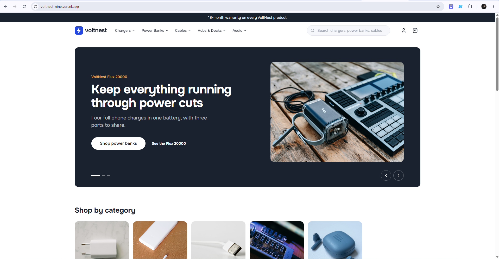
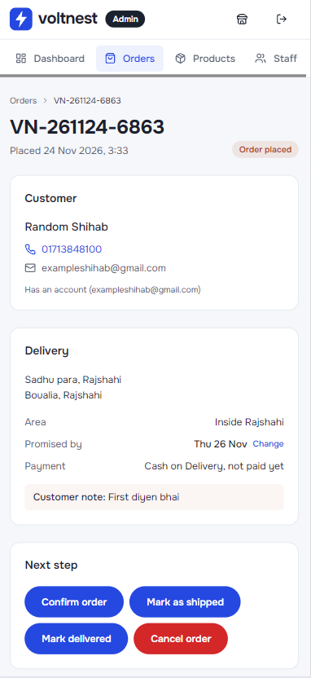
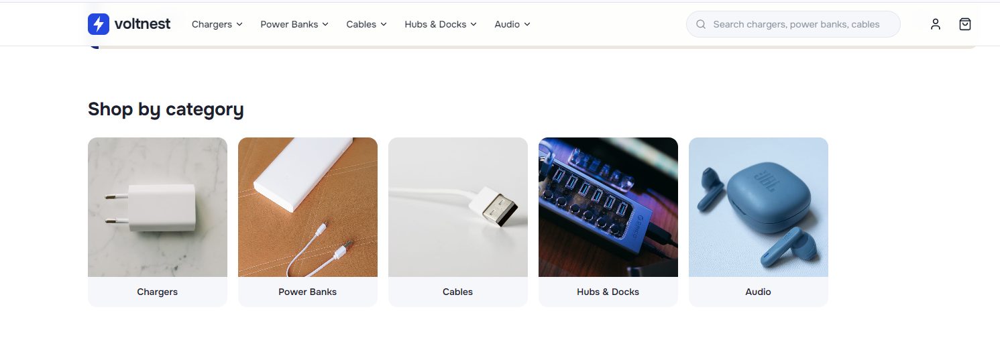
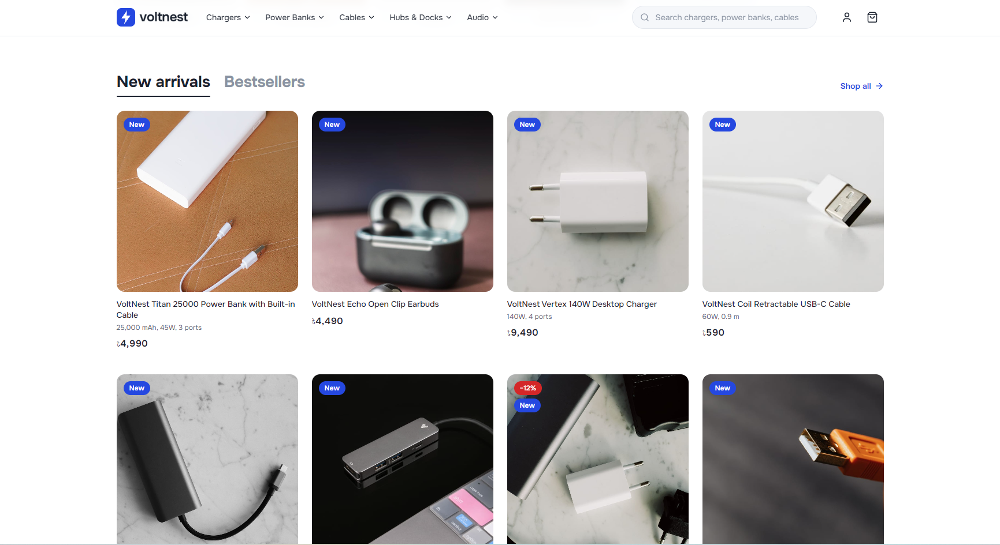
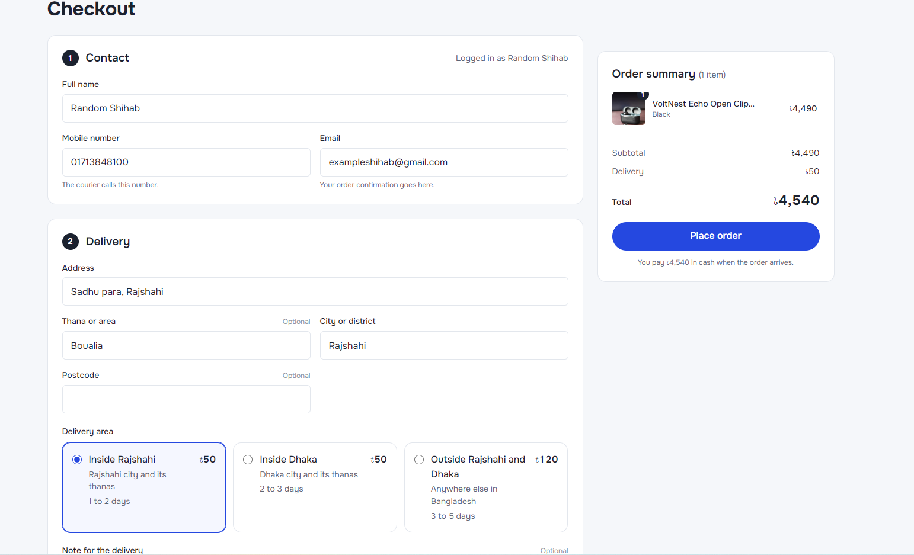
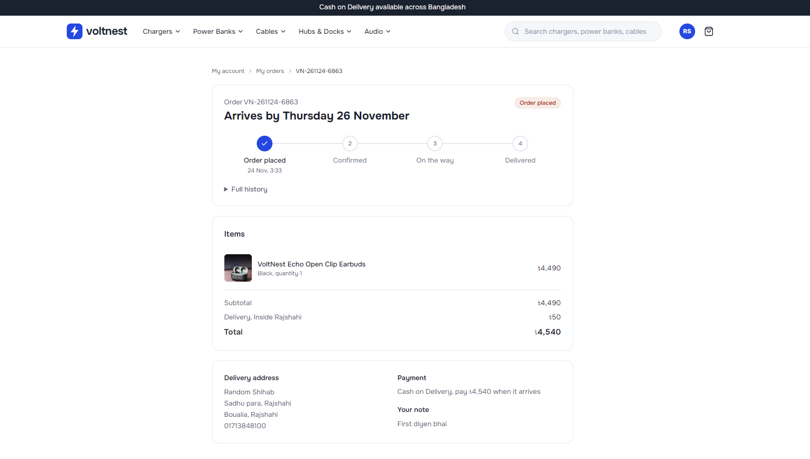
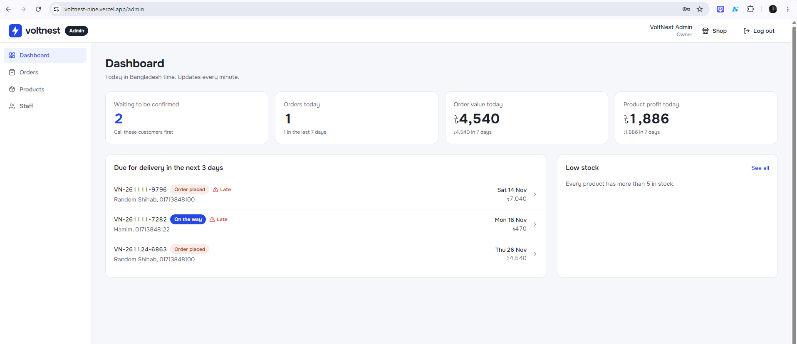
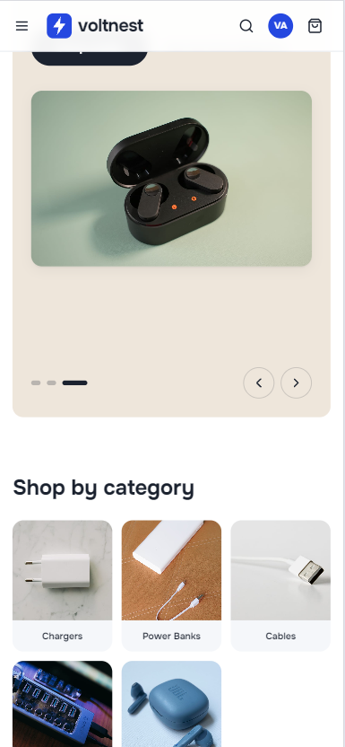
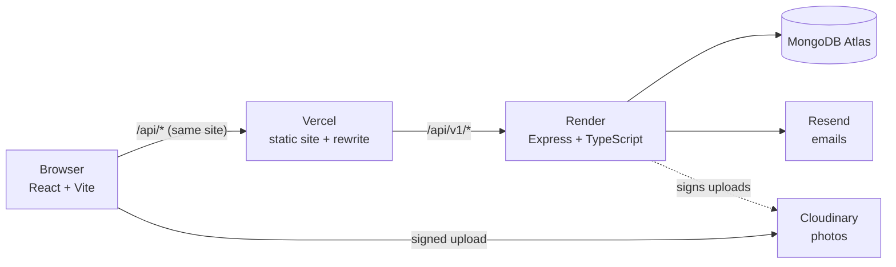

# VoltNest

A full-stack e-commerce shop for charging gear, modelled on how anker.com is structured and behaves, built for the Bangladesh market. Customers browse, filter and order with Cash on Delivery. The owner and employees run orders, stock and products from an admin panel.

**Live:** https://voltnest-nine.vercel.app  ·  **Demo video:** https://youtu.be/xhCIxShUEoA  ·  **API health:** https://voltnest-api.onrender.com/api/v1/health

> Structure and behaviour are inspired by anker.com. All brand names, product names, images and copy are original.



## What it does

**For shoppers**
- Home page with hero carousel, category rail, New arrivals / Bestsellers tabs
- Collection pages with filters (price, wattage, capacity, ports, in stock) kept in the URL, sorting and Load more
- Product pages with gallery, variant picker (`?variant=` in the URL), specs and verified reviews
- Cart that lives on the server: a guest cart follows you when you log in
- Checkout with three delivery zones (Inside Rajshahi ৳50, Inside Dhaka ৳50, elsewhere ৳120) and Cash on Delivery
- Order emails at every step (placed, confirmed, on the way, delivered, cancelled)
- My orders with a status timeline, guest tracking by order number + phone, reviews after delivery

**For the shop**
- Admin panel at `/admin` for the **owner** and **staff**
- Orders: filter, search by number / phone / name, confirm → ship (courier + tracking) → deliver, cancel with stock returned
- Products: create and edit with variants, prices, cost price, stock and photos (Cloudinary)
- Dashboard: orders to confirm, today's orders, value and profit, deliveries due in 3 days, low stock
- Staff accounts the owner can switch off instantly. Staff never see cost, profit or revenue

| | Owner | Staff |
|---|---|---|
| Orders: view, confirm, ship, deliver, cancel | ✓ | ✓ |
| Update stock | ✓ | ✓ |
| Create / edit products and prices | ✓ | |
| Cost price, profit, revenue | ✓ | |
| Manage staff accounts | ✓ | |



## Screenshots

| | |
|---|---|
|  |  |
| **Collection:** filters kept in the URL | **Product:** gallery and variant picker |
|  |  |
| **Checkout:** delivery zones and Cash on Delivery | **My orders:** status timeline |
|  |  |
| **Admin:** dashboard for the owner | **Mobile:** home page at 390 px |

## Architecture



- **Same-site API.** Vercel rewrites `/api/*` to Render, so the browser only ever talks to one site. Login cookies stay `httpOnly`, `Secure` and `SameSite=Lax`, with no CORS headaches.
- **Server decides the money.** The browser sends only contact, address and zone. Prices, delivery charges and totals are calculated on the server from the database, inside a MongoDB transaction that also takes the stock, so two people can never buy the last unit.
- **Snapshots for reporting.** Every order stores `unitPrice`, `unitCost`, `expectedDeliveryDate` and a `statusHistory` with who changed what, so profit and delivery reports stay correct even when prices change later.
- **Safe seeding.** `npm run seed` only updates the catalogue and the owner account. It never deletes users, carts, orders, payments or reviews. A full reset needs `--reset` plus a typed confirmation.
- **Lightweight photos.** Product and banner photos live in `client/public/images` and are served by Vercel's CDN. A `sharp` script resized them for the web, cutting the total from 41.8 MB to 1.9 MB.
- **Three scaling rules.** Every feature has its own folder (`server/src/modules/*`, `client/src/features/*`), every API call is under `/api/v1`, every database call goes through a service.

### Folder map

```
client/src/
  app/router.tsx         every page address (admin pages load on demand)
  pages/                 one file per page; pages/admin/ for the panel
  features/              cart, checkout, auth, orders, reviews, admin…
  layouts/               shop, checkout and admin frames
  shared/                api-client, UI kit, helpers
client/public/images/    hero/ and products/<category>/ photos
client/scripts/          optimize-images.mjs
server/src/
  modules/               auth, carts, orders, products, reviews, admin, notifications…
  shared/                delivery zones, dates, validation, middleware
  config/                env, database, auth, email, Cloudinary
  seed/                  catalogue data and the safe seed
  scripts/order-status.ts
server/tests/            Vitest + Supertest, run against a throwaway MongoDB
```

## Security notes

- Passwords hashed with bcrypt. Access token (15 min) kept in memory only; refresh token (7 days) in an `httpOnly` cookie, rotated on every refresh
- `tokenVersion` revokes every session at once (logout, password reset, switching an employee off)
- Roles re-checked from the database on every admin request, so demotions take effect immediately
- Registration cannot set a role; login rejects MongoDB operator injection such as `{"$ne": null}`
- Rate limits on login and register (20 tries per 15 minutes per IP in production), ordering and guest order lookup
- Order lookups return "not found" for anyone but the owner, staff, or a guest with the matching phone number
- Customer input is escaped in emails; personal responses are `Cache-Control: no-store`; `X-Powered-By` is hidden and Helmet sets security headers
- Secrets live only in `.env` (git-ignored) and in the hosting dashboards. `npm audit --omit=dev` reports no known vulnerabilities in production dependencies

## Tech stack

React 18, TypeScript, Vite, Tailwind CSS, React Router 7, TanStack Query, Zustand · Node 20, Express, Mongoose, Zod 4, JWT, bcrypt · MongoDB Atlas · Resend · Cloudinary · Vitest, Supertest, Playwright · Vercel, Render

## Live demo notes

- **First load can be slow.** The API runs on Render's free plan, which sleeps after 15 quiet minutes. The first request after that can take up to about 50 seconds. A free uptime monitor pinging the health URL every 5 minutes keeps it awake.
- **Emails are off on the live demo.** No Resend key is set, so orders work normally but no email is sent.
- **Admin photo uploads are off on the live demo.** They need Cloudinary keys; the catalogue uses the photos shipped with the site.
- **Payment is Cash on Delivery only.** SSLCommerz appears at checkout as "Not available yet".
- **Admin access** is not public. A demo walkthrough is in the video, and access is available on request.

## Run it locally

You need Node.js 20+ and a MongoDB Atlas connection string.

```bash
# API
cd server
cp .env.example .env     # fill in MONGODB_URI and the two JWT secrets
npm install
npm run seed             # 5 categories, 35 products, 1 owner account (never deletes customer data)
npm run dev              # http://localhost:4000/api/v1/health

# Website (second terminal)
cd client
npm install
npm run dev              # http://localhost:5173
```

Owner login after seeding: `admin@voltnest.test` / the `ADMIN_PASSWORD` in `.env`. Change it before going live.

In `MONGODB_URI`, put the password directly after the username, without the `< >` brackets shown in Atlas's example.

### Environment variables (server)

| Name | Needed | What it is |
|---|---|---|
| `MONGODB_URI` | yes | Atlas connection string, ending in `/voltnest` |
| `MONGODB_USER`, `MONGODB_PASSWORD` | optional | credentials kept out of the URI |
| `JWT_ACCESS_SECRET`, `JWT_REFRESH_SECRET` | yes in production | two different long random strings |
| `CLIENT_URL` | yes | the website's address; used for links in emails |
| `RESEND_API_KEY`, `EMAIL_FROM` | optional | without a key, emails print in the terminal |
| `CLOUDINARY_CLOUD_NAME`, `CLOUDINARY_API_KEY`, `CLOUDINARY_API_SECRET` | optional | without them, paste image links instead of uploading |
| `TRUST_PROXY` | optional | proxies in front of the API; defaults to 2 in production |
| `ADMIN_EMAIL`, `ADMIN_PASSWORD` | seed only | the owner account the seed creates or updates; quote the password if it contains `#` |

### Useful commands

```bash
cd server
npm test                                          # 38 API and service tests
npm run seed                                      # update catalogue + owner, keep customer data
npm run seed -- --reset                           # DANGER: wipe everything (asks you to type RESET)
npm run order:status -- VN-261106-1234 delivered  # change a status from the terminal

cd client
npm run build
node scripts/optimize-images.mjs                  # shrink new photos in public/images to web size
$env:BASE_URL="https://voltnest-nine.vercel.app"; npm run test:smoke   # live smoke test
```

### Adding product photos

1. Save photos as `client/public/images/products/<category>/<category>-01.jpg`, `-02.jpg`, …
2. Set the number of photos for that category in `PHOTO_POOLS` in `server/src/seed/data.ts`
3. Run `node scripts/optimize-images.mjs` in `client`, then `npm run seed` in `server`

## Deploying

Everything runs on free plans. Full guide: [docs/DEPLOY.md](docs/DEPLOY.md).

- **API on Render.** `render.yaml` is a Render Blueprint: root `server`, build `npm ci --include=dev && npm run build`, start `npm start`, health check `/api/v1/health`, Singapore region. Secrets (`MONGODB_URI`, JWT secrets, `CLIENT_URL`) are typed into the Render dashboard, never committed.
- **Website on Vercel.** Root directory `client`, Vite preset, no environment variables. `client/vercel.json` rewrites `/api/*` to the Render API and sends every other path to `index.html`.
- **Database on MongoDB Atlas.** Network access allows `0.0.0.0/0` because Render's free instances have no fixed IP; the database user's password protects it.
- **After the first deploy,** set `CLIENT_URL` on Render to the Vercel address, and add a free uptime monitor for the health URL every 5 minutes.

## What's next

- SSLCommerz online payment (the checkout already shows it as "Not available yet")
- Turn on Resend emails and Cloudinary uploads on the live site
- Phase 2: an AI operations agent for customer chat, a daily report, a finance summary and a review digest, reusing the dashboard service functions
